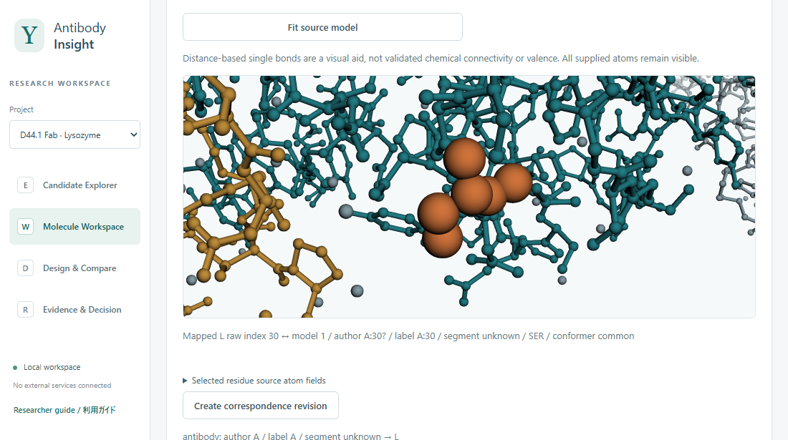

# Antibody Insight

[English](README.md)

**注目した残基から、次の実験へ。**

Antibody Insightは、抗体の配列や構造を、元の試料と測定条件までたどれるローカル研究環境です。
候補を比較し、設計や選定の理由を根拠とともに保存できます。



*リゾチームに結合したD44.1 Fabの構造。橙色で示した軽鎖の配列30番は、登録構造の鎖Aの30番に対応します。[PDB 1MLC](https://www.rcsb.org/structure/1MLC)*

## 起動

WindowsではPython 3.12以降を用意し、プロジェクトのフォルダーで次を実行します。

```powershell
python -m venv .venv
.\.venv\Scripts\python.exe -m pip install -r requirements.txt
.\start.ps1
```

ブラウザーで[ワークスペース](http://127.0.0.1:8765)を開きます。
終了するには端末でCtrl+Cを押します。
Python環境を有効にした端末からは、`python -m workspace_app.server`で直接起動できます。

## 2つの候補を比較する

1. 空のワークスペースで **Explore two paired candidates — synthetic example** を選び、取込内容を確認して合成例を保存します。
2. **Molecule Workspace** で重鎖と軽鎖を比較します。同じ通し番号でアミノ酸が異なる位置が強調されます。
3. **Evidence & Decision** で測定値を元の試料、コンストラクト、測定条件までたどります。熱転移温度の欠測と、別試料で測定条件が異なる箇所を確認します。
4. **Save a shortlist draft** で根拠を選び、候補を残す理由と次に測る項目を入力します。内容を確認して下書きを保存します。

| 画面 | 研究操作 |
| --- | --- |
| **E — Candidate Explorer** | 配列を取り込み、品質を確認します。利用可能な番号対応表でCDR-H3を群分けし、指定した測定条件などに基づいて候補を並べ替えます。 |
| **W — Molecule Workspace** | 鎖の配列と取り込んだIMGT番号を確認し、対応付けた残基を配列と3D構造から選択します。 |
| **D — Design & Compare** | 利用可能な番号対応表で置換位置を指定します。分子構成案や発現コンストラクトを比較し、設計の由来をたどれます。 |
| **R — Evidence & Decision** | 実測と計算結果を確認し、仮説と次の実験を記録します。評価基準を指定した判断の確定や改訂もここで行います。 |

## 手元のデータを取り込む

| 入力 | 操作 |
| --- | --- |
| **FASTA、配列CSV** | **Import data** を開きます。同じ候補の重鎖と軽鎖をまとめるには **FASTA (explicit candidate / chain grouping)** で各レコードの候補、鎖、役割を指定します。通常のFASTAではレコードごとに候補を登録します。 |
| **PDB、mmCIF** | 配列を登録してから、対象の分子を指定して座標を取り込みます。Wで元ファイルの鎖を指定し、残基対応を確認します。 [構造入力の仕様（英語）](docs/STRUCTURE_CONTRACT.md) |
| **ANARCIのIMGTテキスト** | 各ドメインを対象の候補と鎖に割り当てます。Wで照合状態を確認し、元ファイルを取得できます。 [番号付け入力の仕様（英語）](docs/NUMBERING_CONTRACT.md) |
| **実測値** | コンストラクトと試料を登録します。**Measurement CSV** では試料IDを指定するか、元ファイルの試料識別子を明示的に対応付けます。測定値、単位、UTCオフセット付きの測定日時を入力します。 [測定入力の仕様（英語）](docs/MEASUREMENT_CONTRACT.md) |
| **計算結果** | 計算根拠のJSONまたはAlphaFold 3のサマリーJSONを取り込みます。対象とモデルの対応を確認し、元ファイルを参照できます。 [計算結果入力の仕様（英語）](docs/PREDICTION_IMPORT_CONTRACT.md) |

測定値は測定に使った試料に紐づきます。
欠測値は不明のまま保持し、モデルの信頼度指標と実測値は区別して表示します。

## 保存先と資料

アプリはローカルで動作し、構造ビューアーも同梱しています。
Windowsの既定の保存先は `%LOCALAPPDATA%\AntibodyInsight\workspace.sqlite3` です。
**Export JSON** で書き出したプロジェクトは、新しいデータベースに取り込めます。
別の保存先で起動するには、`start.ps1` に `-Database`、直接起動するコマンドに `--database` で保存先を指定します。

画面のラベルは英語です。
**Researcher guide / 利用ガイド** では説明を英語と日本語で切り替えられます。

[データ形式](docs/DATA_CONTRACT.md) ｜ [判断記録の仕様（英語）](docs/DECISION_CONTRACT.md) ｜ [既知の制約（英語）](KNOWN_LIMITATIONS.md)

このリポジトリは開発版です。[リリース状況（英語）](docs/PROGRESS.md)

[Apache-2.0ライセンス](LICENSE) ｜ [同梱ライブラリのライセンス](THIRD_PARTY_NOTICES.md)
