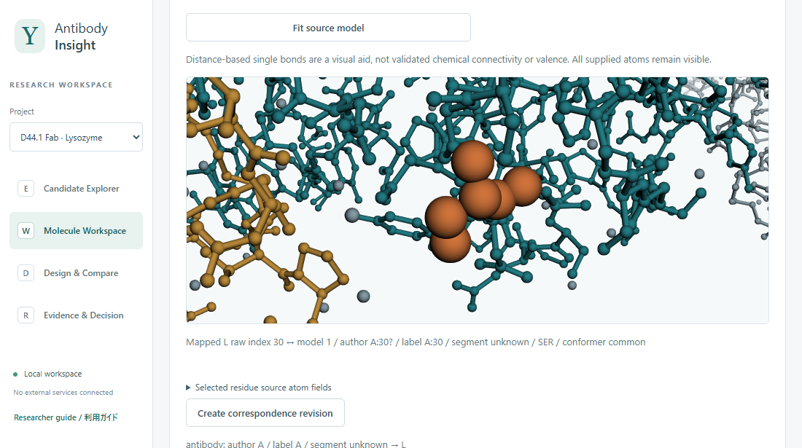

# Antibody Insight

[日本語](README.ja.md)

**Follow an antibody from the residue you observe to the experiment you propose.**

Antibody Insight is a local workspace for antibody research. Compare candidates, connect sequence and structure to the original samples and assay conditions, and save the evidence behind a design or selection.



*Molecule Workspace with D44.1 Fab bound to lysozyme. Orange highlights the selected light-chain residue, mapped from sequence position 30 to deposited chain A, position 30. [PDB 1MLC](https://www.rcsb.org/structure/1MLC)*

## Start the workspace

With Python 3.12 or later, run these commands in the project directory on Windows.

```powershell
python -m venv .venv
.\.venv\Scripts\python.exe -m pip install -r requirements.txt
.\start.ps1
```

Open [the workspace](http://127.0.0.1:8765) in your browser. Press Ctrl+C in the terminal to stop it. To start directly from an active Python environment, run `python -m workspace_app.server`.

## Compare two candidates

1. On an empty workspace, choose **Explore two paired candidates — synthetic example**, review the import and save it.
2. In **Molecule Workspace**, compare the heavy and light chains. The example highlights differences at the same raw sequence index.
3. In **Evidence & Decision**, trace a measurement to its sample, construct and assay conditions. Look for the missing thermal measurement and the change in conditions for the alternate sample.
4. Under **Save a shortlist draft**, select the evidence, record why the candidates merit further study and state what to measure next. Review and save the draft.

| Screen | Research task |
| --- | --- |
| **E · Candidate Explorer** | Import and check sequences, group candidates by CDR-H3 when eligible numbering is available, and sort by an explicitly selected observation context. |
| **W · Molecule Workspace** | Compare chains, inspect imported IMGT numbering and select corresponding residues in a mapped 3D structure. |
| **D · Design & Compare** | Preview a substitution using eligible numbering, compare declared molecular designs or expression constructs, and retain the source of each design. |
| **R · Evidence & Decision** | Inspect measured and computed evidence, record a hypothesis and next experiment, or finalize and revise a criteria-based decision. |

## Use your own data

| Input | How to bring it in |
| --- | --- |
| **FASTA or sequence CSV** | Use **Import data**. For heavy and light chains of one candidate, choose **FASTA (explicit candidate / chain grouping)** and declare each record’s candidate, chain and role. Ordinary FASTA creates one candidate per record. |
| **PDB or mmCIF** | Register the sequence first, then import the coordinates against that molecule. In W, assign source chains before reviewing the residue correspondence. [Structure inputs](docs/STRUCTURE_CONTRACT.md) |
| **ANARCI IMGT text** | Bind each numbered domain to its candidate and chain. W displays the review status and lets you retrieve the original output. [Numbering inputs](docs/NUMBERING_CONTRACT.md) |
| **Measurements** | Register the construct and material. In **Measurement CSV**, supply the material ID or explicitly bind the source sample reference. Include the value, unit and timezone-bearing measurement time. [Measurement inputs](docs/MEASUREMENT_CONTRACT.md) |
| **Computed results** | Import computed-evidence JSON or AlphaFold 3 summary JSON. Review the subject and model associations and inspect the retained source. [Computed inputs](docs/PREDICTION_IMPORT_CONTRACT.md) |

Measurements stay attached to the material tested. Missing values remain unknown, and model confidence is shown separately from experimental results.

## Local data and documentation

The application runs on loopback and serves the structure viewer locally. On Windows, the default database is `%LOCALAPPDATA%\AntibodyInsight\workspace.sqlite3`. **Export JSON** saves a project archive that can be restored into a fresh database. For a separate workspace, use `-Database` with `start.ps1` or `--database` with the direct server command.

The app uses English interface labels. Open **Researcher guide / 利用ガイド** to switch its explanations between English and Japanese.

[Data format](docs/DATA_CONTRACT.md) · [Decision records](docs/DECISION_CONTRACT.md) · [Known limitations](KNOWN_LIMITATIONS.md)

This repository contains the development build. [Release status](docs/PROGRESS.md)

[Apache-2.0 license](LICENSE) · [Third-party notices](THIRD_PARTY_NOTICES.md)
